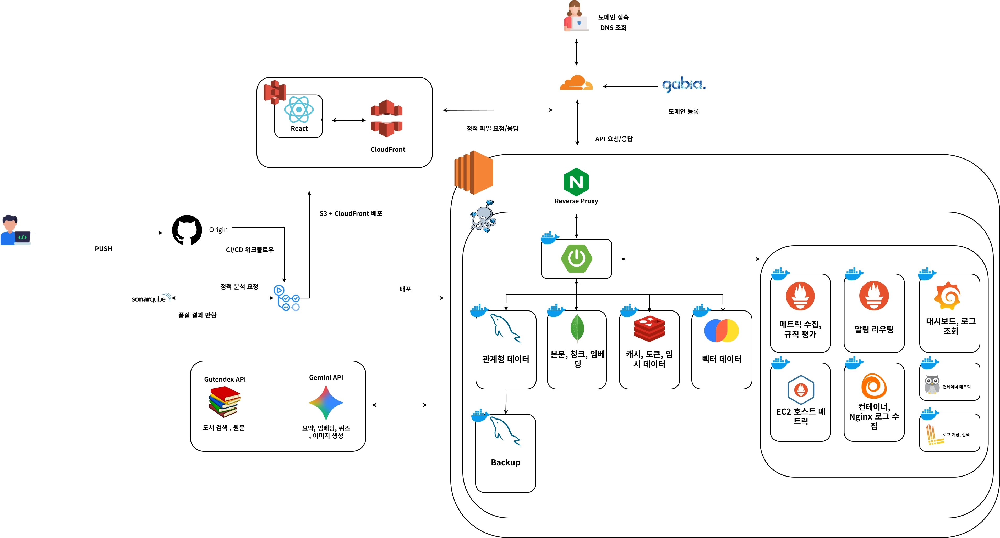
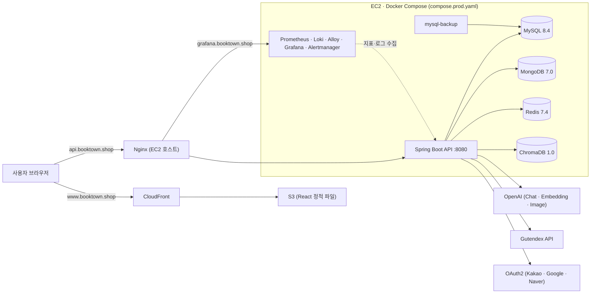
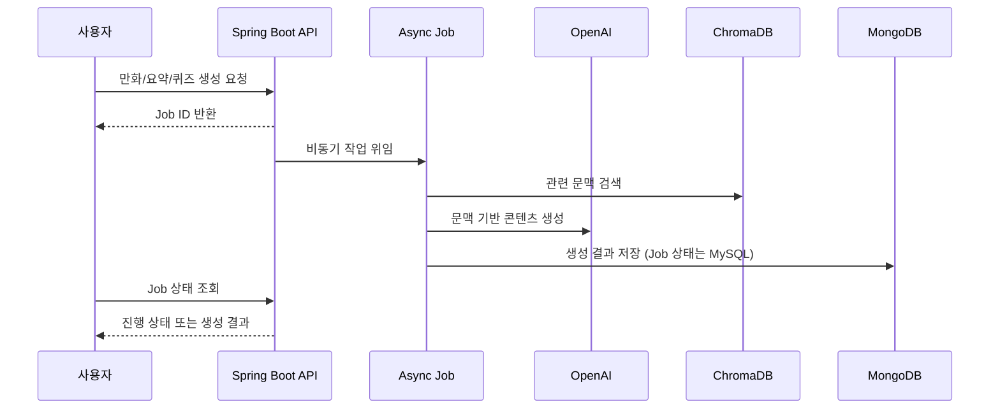
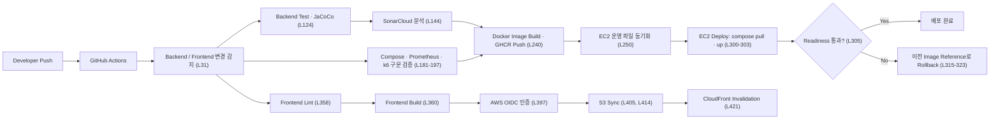
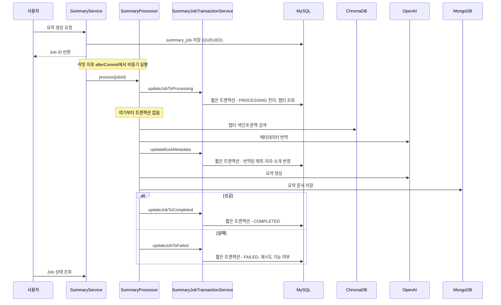
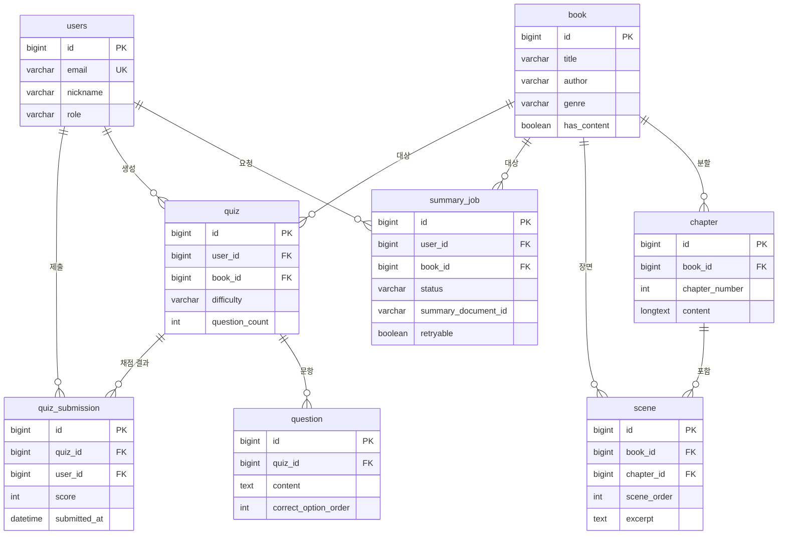

# BookTown V2

팀 프로젝트(4명, 2025.03–06) BookTown을 개인 저장소에서 다시 정리한 버전입니다. 팀 원본: [BookTown_Back_end](https://github.com/BookTown/BookTown_Back_end) · [BookTown_Front_end](https://github.com/BookTown/BookTown_Front_end)

> 고전 문학 원문을 수집하고 OpenAI 기반으로 만화·요약·퀴즈를 생성하여 독서 경험으로 연결한 풀스택 서비스입니다.


## 한눈에 보기

| 항목 | 내용 |
| --- | --- |
| 서비스 | 고전 문학 원문을 가져와 AI로 요약·장면 이미지·퀴즈를 만들어 주는 독서 서비스입니다. |
| 기간 | 팀 프로젝트 2025.03–2025.06, V2 개인 재정리 2026.06–2026.08 |
| 인원 | 팀 4명(FE 2, BE 2), V2는 1명 |
| 내 역할 | 백엔드. V2에서는 백엔드·프론트엔드·배포를 혼자 다시 만들었습니다. |
| 기술 스택 | Java 21, Spring Boot 4.0.6, Spring AI(OpenAI), MySQL·MongoDB·Redis·ChromaDB, React 19, Docker Compose, GitHub Actions, AWS EC2·S3·CloudFront |

## 내가 맡은 일

**팀 프로젝트 (2025.03–06)**

- Gutendex에서 고전 원문을 가져오는 수집 기능을 만들었습니다. ([BookService](https://github.com/BookTown/BookTown_Back_end/blob/master/src/main/java/hello/booktown/service/BookService.java))
- 장면별 요약, 장면 이미지 생성, S3 업로드를 구현했습니다. ([SummaryService](https://github.com/BookTown/BookTown_Back_end/blob/master/src/main/java/hello/booktown/service/SummaryService.java), [StabilityAIService](https://github.com/BookTown/BookTown_Back_end/blob/master/src/main/java/hello/booktown/service/StabilityAIService.java), [S3UploadService](https://github.com/BookTown/BookTown_Back_end/blob/master/src/main/java/hello/booktown/service/S3UploadService.java))
- 퀴즈 생성·채점 API와 EC2 배포 워크플로를 만들었습니다. ([QuizService](https://github.com/BookTown/BookTown_Back_end/blob/master/src/main/java/hello/booktown/service/QuizService.java), [gradle.yml](https://github.com/BookTown/BookTown_Back_end/blob/master/.github/workflows/gradle.yml))

**V2 개인 정리 (2026.06–08)**

- 요약·퀴즈·이미지 생성을 Job 상태로 관리하는 Spring AI·ChromaDB 비동기 파이프라인으로 다시 만들었습니다.
- 롤백을 포함한 백엔드 EC2 배포와 S3·CloudFront 프론트 배포를 구성했습니다. ([cicd.yml](.github/workflows/cicd.yml))

## 문제를 고친 기록

### 1. AI 응답을 기다리며 DB 커넥션을 붙잡던 요약 작업

- **문제**: 요약 처리 메서드 전체에 `@Transactional`이 걸려, OpenAI 응답을 기다리는 동안 DB 커넥션이 묶였습니다.
- **원인**: 외부 호출 시간이 그대로 커넥션 점유 시간이 되는 구조였습니다. 요약 스레드는 최대 4개([AsyncConfig](BookTown-V2-Backend/src/main/java/com/booktown/global/config/AsyncConfig.java)), 커넥션 풀은 기본값 10개인 것을 설정에서 확인했습니다.
- **해결**: 상태 변경만 [SummaryJobTransactionService](BookTown-V2-Backend/src/main/java/com/booktown/domain/summary/service/SummaryJobTransactionService.java)의 짧은 트랜잭션으로 옮기고, RAG 검색과 OpenAI 호출은 트랜잭션 밖으로 뺐습니다.
- **결과**: 처리 메서드에 트랜잭션을 다시 씌우면 [SummaryTransactionBoundaryTest](BookTown-V2-Backend/src/test/java/com/booktown/domain/summary/service/SummaryTransactionBoundaryTest.java)가 실패합니다. ([050f6e1](https://github.com/Sungw0o/Booktown-V2/commit/050f6e1))

### 2. 퀴즈 이력 조회가 전체 행을 읽고 정렬하던 문제

- **문제**: 최근 제출 20건 조회가 `user_id` 단일 인덱스만 써서, 제출이 많은 사용자는 모든 행을 읽고 따로 정렬했습니다.
- **원인**: 한 사용자에 10만 건을 둔 재현 데이터에서 `EXPLAIN ANALYZE`로 10만 행 읽기와 Sort 단계를 확인했습니다. ([재현 SQL](BookTown-V2-Backend/performance/mysql/quiz-history-index/setup-before.sql))
- **해결**: `(user_id, submitted_at DESC)` 복합 인덱스로 바꾸고 [QuizSubmissionIndexTest](BookTown-V2-Backend/src/test/java/com/booktown/domain/quiz/entity/QuizSubmissionIndexTest.java)로 고정했습니다.
- **결과**: 읽은 행이 100,000에서 20으로, 실행 시간 중앙값이 66.7ms에서 2.02ms로 줄었습니다. MySQL 8.4에서 전후 각 5회 `EXPLAIN ANALYZE`로 쟀습니다. ([보고서](BookTown-V2-Backend/docs/QUIZ_HISTORY_INDEX_PERFORMANCE.md))

### 3. 동시 재발급에 정상 세션까지 폐기되던 Refresh Token

- **문제**: 여러 탭이 같은 Refresh Token으로 동시에 재발급하면 하나만 성공하고 나머지는 세션이 폐기됐습니다.
- **원인**: Redis 7.4에 32개 동시 요청을 보내는 통합 테스트에서 1건 성공, 31건 거절을 확인했습니다. Lua 스크립트가 토큰이 다르면 바로 키를 지웠습니다.
- **해결**: 교체 직전 토큰을 15초 동안 함께 저장하고, 그 안에 온 이전 토큰에는 현재 토큰을 돌려주게 했습니다. ([RefreshTokenService](BookTown-V2-Backend/src/main/java/com/booktown/domain/auth/service/RefreshTokenService.java))
- **결과**: 같은 테스트에서 교체 1건, 같은 토큰 반환 31건, 실패 0건으로 끝났습니다. ([테스트 기록](BookTown-V2-Backend/docs/REDIS_REFRESH_TOKEN_CONCURRENCY_TEST.md), [a31c7ec](https://github.com/Sungw0o/Booktown-V2/commit/a31c7ec))

## 💻 Tech Stacks

| 구분 | 기술 |
| --- | --- |
| Backend | Java 21, Spring Boot 4.0.6, Spring MVC, Spring Security, Spring Data JPA/MongoDB/Redis |
| AI | Spring AI 2.0.0-M6, OpenAI Chat/Embedding/Image, ChromaDB RAG |
| Frontend | React 19.2, TypeScript 6, Vite 8, React Router 7, TanStack Query 5, Axios, Tailwind CSS 4 |
| Data | MySQL 8.4, MongoDB, Redis 7.4, ChromaDB 1.0 |
| Infrastructure | Docker Compose, Nginx, Amazon EC2, S3, CloudFront, Route 53 |
| Observability | Prometheus, Grafana, Loki, Grafana Alloy, Micrometer |
| CI/CD | GitHub Actions, GHCR, AWS OIDC, S3 Sync, CloudFront Invalidation |
| Test | JUnit 5, Spring Boot Test, Testcontainers, Vitest, k6, JaCoCo, SonarCloud |

## 🏗️ System Architecture



### 시스템 구성도



컨테이너 구성은 [compose.prod.yaml](BookTown-V2-Backend/compose.prod.yaml), Grafana 프록시는 [ops/nginx](BookTown-V2-Backend/ops/nginx/grafana.booktown.shop.conf), 외부 API는 [application.yml](BookTown-V2-Backend/src/main/resources/application.yml)과 [GutendexClient](BookTown-V2-Backend/src/main/java/com/booktown/domain/admin/gutendex/GutendexClient.java), 프론트 배포 경로는 [cicd.yml](.github/workflows/cicd.yml)에 정의되어 있습니다.

### AI 콘텐츠 생성 흐름



관계형 데이터, 긴 원문/생성 콘텐츠, 단기 상태, 임베딩 벡터를 각각 MySQL·MongoDB·Redis·ChromaDB에 배치했습니다. AI 호출은 HTTP 요청 수명과 분리된 비동기 Job으로 실행하며, 클라이언트는 Job ID로 상태를 조회합니다.

## 🚀 CI/CD Pipeline



괄호 안 줄 번호는 모두 [.github/workflows/cicd.yml](.github/workflows/cicd.yml) 기준입니다. PR에서는 배포 없이 이미지 빌드만 확인합니다(L133).

- 백엔드는 테스트와 정적 분석 단계를 거친 이미지만 GHCR에 푸시합니다.
- EC2 배포 직전 현재 실행 이미지의 정확한 reference를 보존하고, readiness 실패 시 해당 이미지로 되돌리도록 구성했습니다.
- 프론트엔드는 장기 AWS Access Key 없이 GitHub OIDC로 인증해 S3에 동기화하고 CloudFront 캐시를 무효화합니다.
- Compose와 Prometheus 설정, k6 스크립트도 워크플로에서 구문 검증합니다.

> 자동 롤백 로직은 워크플로에 구현되어 있습니다. 의도적인 장애 주입과 실제 복원 로그를 이용한 런타임 검증은 아직 남아 있습니다.

### Validation Status

| 항목 | 상태 |
| --- | --- |
| Backend unit/integration test | GitHub Actions에서 자동 실행 |
| JaCoCo / SonarCloud | 품질 리포트 자동 생성 |
| Frontend build/test | Vite/Vitest 기반 검증 |
| Readiness | MySQL, Redis, MongoDB, ChromaDB 상태 확인 |
| k6 | 스크립트 구문과 스모크 시나리오 구성, 성능 수치 추가 측정 필요 |
| Rollback | 파이프라인 구현 완료, 장애 주입 기반 복원 증거 필요 |

## 핵심 흐름: AI 요약 Job의 트랜잭션 경계

[문제를 고친 기록 1](#1-ai-응답을-기다리는-동안-db-커넥션을-붙잡던-요약-작업)의 구조입니다. DB 트랜잭션은 상태를 바꾸는 순간에만 열고, 외부 호출은 트랜잭션 밖에서 실행합니다.



근거: [SummaryService](BookTown-V2-Backend/src/main/java/com/booktown/domain/summary/service/SummaryService.java)(afterCommit 등록), [SummaryProcessor](BookTown-V2-Backend/src/main/java/com/booktown/domain/summary/service/SummaryProcessor.java), [SummaryJobTransactionService](BookTown-V2-Backend/src/main/java/com/booktown/domain/summary/service/SummaryJobTransactionService.java)

## ERD

[schema.sql](BookTown-V2-Backend/src/main/resources/db/schema.sql)의 핵심 테이블 8개입니다. 요약 본문과 생성 이미지는 MongoDB에 두고 `summary_job.summary_document_id`로 연결합니다.



## ✨ 주요 기능 (Key Features)

| 영역 | 주요 기능 |
| --- | --- |
| 도서 탐색 | Gutendex 검색과 도서 가져오기, 원문 열람, 도서 목록·상세·검색 |
| AI 요약 | 원문과 벡터 검색 문맥을 활용한 비동기 요약 생성, 작업 상태 조회 |
| AI 퀴즈 | 도서 기반 퀴즈 생성, 답안 제출과 결과 확인 |
| AI 만화 | 장면 기반 이미지 생성, 만화 작업 이력과 결과 조회 |
| 개인화 | 북마크, 독서 콘텐츠 관리, 사용자별 상태 제공 |
| 인증/보안 | JWT, OAuth2, HttpOnly Refresh Token, Redis Lua 원자적 토큰 회전, Turnstile |
| 운영 | MySQL·Redis·MongoDB·ChromaDB readiness, Micrometer 지표, 로그 수집 구성 |
| 관리자 | 도서/사용자/AI 작업 현황을 확인하는 관리자 대시보드 |

## 🛠️ Local Development

```powershell
Copy-Item .env.example .env
docker compose up -d --build
docker compose ps
```

백엔드와 프론트엔드를 개별 실행할 수도 있습니다.

```powershell
Set-Location BookTown-V2-Backend
./gradlew bootRun

Set-Location ../BookTown-V2-Frontend
npm ci
npm run dev
```

`OPENAI_API_KEY`, 데이터베이스 비밀번호, OAuth 자격증명 등 실제 Secret은 `.env` 또는 배포 환경에만 설정합니다.

## 📁 Repository Structure

```text
BookTown-V2/
├─ BookTown-V2-Backend/      # Spring Boot API와 AI 파이프라인
│  ├─ ops/                   # Nginx 등 EC2 운영 설정
│  ├─ monitoring/            # Prometheus, Grafana, Loki, Alloy
│  ├─ performance/           # k6 시나리오
│  └─ compose.yaml           # 로컬 애플리케이션과 인프라
├─ BookTown-V2-Frontend/     # React 사용자/관리자 화면
├─ docs/                     # 아키텍처와 운영 문서
└─ .github/workflows/        # CI/CD 워크플로
```
